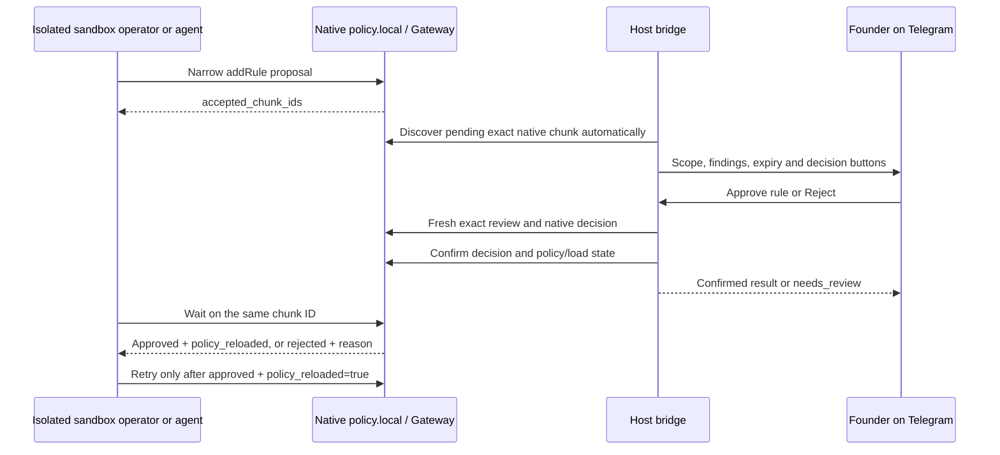

# Telegram approval: first real run

For the guided single-terminal workflow, run `openshell-manager approval test`;
see [the one-command runbook](telegram-approval-test.md). This document retains
manual deployment/diagnostic detail.

This is an **operator-executed procedure**, not evidence of a completed live test.
The implementation has offline coverage; B15 remains SKIP until the evidence below
is collected. Follow the [main runbook](telegram-approval-p1.md) for supported scope,
queue recovery and native rejection limitations. Use an explicitly authorized
**isolated test sandbox**, not the active development VM. No paid agent/model call
is necessary: an operator can exercise the agent-side native proposal protocol.

## 1. Release and isolation gate

Record the reviewed full Manager commit SHA, operator, test date, isolated project
ID, sandbox name/UUID, existing Gateway name and workspace. These are private test
records; do not paste host state or credentials into Git.

Before proceeding, verify:

- OpenShell is already pinned to **0.1.2**. No native upgrades or active Gateway/VM
  changes are part of this procedure.
- The isolated sandbox is already provisioned through the reviewed Manager flow,
  Ready, and bound to this project's private state. Its effective policy is
  admitted/loaded and proposal approval mode resolves to **MANUAL**. Native
  `policy.local` proposal support is already available.
- An existing **local HTTPS mTLS Gateway** and existing host credentials are
  available. The metadata and credential layout/permissions meet the main runbook.
  Never copy host Gateway keys or the Telegram token into the sandbox.
- A dedicated bot and trusted numeric Founder `user_id` and `chat_id` already exist.
  No other process polls this bot. One host, project and canonical state root are
  used. Coordinate native review so no independent administrator races this test.
- The operator has approved an exact, public, noncredentialed test hostname and
  two harmless HTTPS GET paths, neither already allowed for `/usr/bin/curl`.
  The host must not be GitHub, private/link-local, wildcarded or provider-credentialed.
  Verify `/usr/bin/curl` is the actual executable in this sandbox.

**Stop with BLOCKED** if any prerequisite requires credentials, broader permissions,
new native settings, sandbox changes or an upgrade. Obtain a separate decision;
do not work around a refused guard. A missing approval button is not permission to
use a broader native policy update. Native rejection has no server-side CAS in
0.1.2; if this limitation is unacceptable, do not deploy this bridge.

## 2. Install the reviewed commit and prepare private inputs

On the **host**, install only a reviewed immutable commit as described in
[packaging.md](../packaging.md):

```bash
uv tool install 'git+https://github.com/phuongtuan1803/openshell-manager.git@<FULL_REVIEWED_COMMIT_SHA>'
openshell-manager version
```

For an existing tool installation use the packaging procedure with the reviewed
commit; installation never starts this bridge. The isolated project profile's
`manager_revision` must match the installed commit. Any profile/binding migration
requires review; do not edit receipts or delete state to bypass provenance.

Set these shell variables to existing **host** paths. The bot JSON must be outside
source trees, guest mounts, snapshots and Git. Never put its contents in a shell
argument, screenshot, ticket or terminal recording.

```bash
export MANAGER_PROJECT=/ABSOLUTE/PRIVATE/isolated-project.json
export MANAGER_HOST=/ABSOLUTE/PRIVATE/host.json
APPROVAL_BOT_CONFIG=/ABSOLUTE/PRIVATE/telegram.json
APPROVAL_GATEWAY=EXISTING_LOCAL_GATEWAY
APPROVAL_WORKSPACE=default
```

The existing bot JSON has exactly `bot_token`, `user_id`, `chat_id`. Use a private
editor to enter it if separately authorized; do not fetch IDs using an untrusted
bot. The host file must be owned by the service user, mode 0600, with no links.
State and credential directories require 0700. Inspect permissions without printing
file contents. Do not recursively change permissions on the native config tree.

```bash
stat -c '%a %U %n' "$APPROVAL_BOT_CONFIG"
openshell-manager approval setup --project "$MANAGER_PROJECT" --host "$MANAGER_HOST"
openshell-manager approval status --project "$MANAGER_PROJECT" --host "$MANAGER_HOST"
```

`setup` validates/configures Manager's local binding/template state only. It does
not enable native proposals, create bot/Gateway credentials or activate systemd.
`status`/`pending` are local read-only observations, not live connectivity probes.
Do not run core `setup` apply, `refresh`, `cleanup` or provisioning commands here.

## 3. Start the bridge in the foreground

On the **host**, start exactly one bridge and leave the terminal running:

```bash
openshell-manager approval serve \
  --project "$MANAGER_PROJECT" --host "$MANAGER_HOST" \
  --bot-config "$APPROVAL_BOT_CONFIG" \
  --gateway "$APPROVAL_GATEWAY" --gateway-workspace "$APPROVAL_WORKSPACE"
```

In another host terminal, using the same project/host variables:

```bash
openshell-manager approval status --project "$MANAGER_PROJECT" --host "$MANAGER_HOST"
openshell-manager approval pending --project "$MANAGER_PROJECT" --host "$MANAGER_HOST"
```

Check the last native observation is verified and current. A running process alone
is insufficient. **Without `--gateway`, serve is notification-only fallback** and
cannot meet this acceptance test. BLOCKED/native-unavailable must be resolved by
reviewing the existing supported configuration, never bypassing identity checks.
No manual `rules pending` refresh is required for discovery.



## 4. Submit a native request from inside the isolated sandbox

Use an **already authorized shell connection** to the isolated sandbox. Do not run
these commands on the host, reconnect to the active VM or invoke a paid agent.
Read its installed `/etc/openshell/skills/policy_advisor.md`; this recipe follows
[the exact v0.1.2 native guide](https://github.com/NVIDIA/OpenShell/blob/6648bd0c290efbc41ba131ee9831ee45cd431f94/crates/openshell-supervisor-process/src/skills/policy_advisor.md).
The native guide's GitHub/auto examples are outside this bridge's allowed scope.

Choose the separately approved exact hostname and first harmless path below.
`public.example.org` and `/approval-probe-a` are **placeholders**, not a test server.
Keep query strings, credentials, custom auth headers and request bodies out of the
probe. Confirm a pre-proposal request is denied by policy, rather than merely
failing DNS/TLS or receiving an upstream HTTP error. If it is already allowed,
choose a different reviewed scope; do not revoke/change existing policy here.

```bash
/usr/bin/curl --max-time 20 --silent --show-error \
  https://public.example.org/approval-probe-a
/usr/bin/curl --max-time 20 --silent --show-error \
  http://policy.local/v1/policy/current
```

Native mechanistic denial drafts may also appear; they can be too broad for an
Approve button. Submit the following explicit REST proposal using the operator's
actual reviewed hostname/path. This creates a **real native proposal**, not a
Manager inbox entry. The request file contains no host secrets.

```bash
umask 077
cat > /tmp/telegram-approval-probe.json <<'JSON'
{
  "intent_summary": "Isolated Telegram approval acceptance: public GET only",
  "operations": [{
    "addRule": {
      "ruleName": "telegram_probe_a",
      "rule": {
        "name": "telegram_probe_a",
        "endpoints": [{
          "host": "public.example.org",
          "port": 443,
          "protocol": "rest",
          "enforcement": "enforce",
          "rules": [{"allow": {"method": "GET", "path": "/approval-probe-a"}}]
        }],
        "binaries": [{"path": "/usr/bin/curl"}]
      }
    }
  }]
}
JSON
/usr/bin/curl --max-time 30 --silent --show-error \
  -H 'Content-Type: application/json' \
  --data-binary @/tmp/telegram-approval-probe.json \
  --write-out '\nHTTP %{http_code}\n' \
  http://policy.local/v1/proposals
```

Require HTTP 202, one `accepted_chunk_ids` entry, no `rejection_reasons`, and a
pending native state. Save that **actual returned ID**, not a rule name, endpoint
hash or mechanistic draft ID. If the response fails or the feature returns 404,
stop and record BLOCKED; do not enable settings on an active VM. Native duplicate
submission may reuse an existing proposal: do not invent a new generation.

## 5. Approve and prove enforcement

Within the default 15-minute window:

1. Without running any host rules-refresh command, wait for Telegram notification.
   Normally discovery follows an outbound poll cycle; allow about 60 seconds before
   diagnosing. Match the exact isolated project/sandbox, native chunk ID,
   `/usr/bin/curl`, hostname, 443, GET and complete path. Review risk findings,
   policy fingerprint and expiry. Details must refer to the same request.
2. Tap **Approve rule** from the configured user in the configured chat. This is a
   runtime rule grant that may outlive this request, not a one-time permission.
3. Require confirmed approval in Telegram. `needs_review` or a button press alone
   is not success. Inspect host `approval status`/`pending` and retain the matching
   sanitized audit outcome privately.
4. In the isolated sandbox, use the actual accepted chunk ID:

   ```bash
   APPROVAL_CHUNK_ID='<ACTUAL_ACCEPTED_CHUNK_ID>'
   /usr/bin/curl --max-time 310 --silent --show-error \
     "http://policy.local/v1/proposals/$APPROVAL_CHUNK_ID/wait?timeout=300"
   ```

   Require `status: "approved"` **and** `policy_reloaded: true`. If reload is false,
   wait once more with `timeout=30`; if still false, stop and investigate, without
   blindly approving or retrying again.
5. Retry precisely the original GET. Require evidence the native policy now admits
   the request. An upstream 404 can prove network admission but is not an HTTP
   application success; record the distinction. DNS/TLS failures alone prove neither.
   Do not broaden method/path/binary or add credentials to make the test pass.
6. Re-tap an old decision if the client permits it: no second native mutation may
   occur. It is normal for successful status edits to remove the buttons.

## 6. Reject and prove default deny

Use the second separately reviewed path, e.g. `/approval-probe-b`, with a new rule
name `telegram_probe_b`. Repeat section 4 with those changes and record the actual
new chunk ID. The second path must be outside the first approved exact path.

Tap **Reject**, require confirmed rejection, then wait on that exact chunk as in
section 5. Require `status: "rejected"` and a rejection reason. Retrying the second
GET must remain policy-denied. The client/agent may submit a narrower new proposal;
it must receive its own native identity and new review. Never reapprove a rejected
chunk through a broader native command to simulate a fresh request.

For repeated-scope evidence, submit another native request for the rejected second
scope and record whether OpenShell creates a new chunk. A genuinely new chunk must
produce a fresh notice, even for identical endpoint scope. If native dedup returns
the same old chunk, record that result; Manager cannot turn it into a new request.

## 7. Reliability and expiry checks

Run these only in the same authorized isolated test, with harmless pending scopes:

| Check | Procedure and required result |
| --- | --- |
| Expiry | Leave a fresh notice untouched for 15 minutes. Old approval must be refused; any renewed notice must have a fresh review generation/tokens. No policy grant occurs from expiry. |
| Unauthorized identity | If a separately authorized second test account/chat is available, its callback must be refused. Do not add IDs to the allowlist. Otherwise record live SKIP; offline coverage exists. |
| Bridge restart | Stop/restart only the Manager bridge, preserving SQLite. One active proposal must not be resent as duplicate active authority. Never restart the Gateway/VM. |
| Telegram outage | If already available, use an authorized noninvasive connectivity test; otherwise record live SKIP. Pending permission remains denied. Do not change host networking merely for this check. |
| Uncertain mutation | Do not deliberately kill native resources or inject a real credential/network fault. Keep offline crash tests as evidence; a naturally occurring needs_review is reconciled by reads only. |

Do not export SQLite raw: callback hashes, internal bindings and audit details
remain private. Record only sanitized IDs/status/timestamps and policy hashes
necessary for acceptance. Screenshots must exclude tokens, keys, private paths,
provider data and unrelated chat content.

## 8. Stop or explicitly enable the user service

To end the foreground test, Ctrl-C or request cooperative stop from another host
terminal:

```bash
openshell-manager approval stop --project "$MANAGER_PROJECT" --host "$MANAGER_HOST"
```

Wait for the current bounded outbound call and clean exit. Do not delete locks or
queue state. Stopping this bridge **does not revoke previously approved rules**.
Any test sandbox cleanup or rule revocation is a separate reviewed native operation.

Only after successful isolated acceptance and an explicit deployment decision,
review/copy the [systemd template](openshell-manager-approval.service). Replace all
absolute paths and Gateway/workspace placeholders; ensure the service user's HOME
or XDG_CONFIG_HOME resolves the same existing native credential registry. Never put
a token in ExecStart/Environment. Stop the foreground bridge before starting systemd.

```bash
systemctl --user daemon-reload
systemctl --user enable --now openshell-manager-approval.service
systemctl --user status openshell-manager-approval.service
```

For rollback:

```bash
systemctl --user disable --now openshell-manager-approval.service
```

Preserve audit and return to native manual host review. Do not enable lingering,
change Gateway/VM settings or silently migrate production project pins. The existing
Manager policy-drift guard can require separately reviewed reconciliation after a
native runtime grant; never rewrite the recorded reviewed policy to suppress it.

## Acceptance record

Keep a private record using this template, then add only sanitized results to
[PR3b acceptance](../pr3b-acceptance.md). Mark B15 PASS only when both native decisions,
policy enforcement and the normal agent-side wait/retry/rejection are evidenced.
An operator protocol probe should be labeled as such; an actual agent run remains
SKIP unless separately performed without unauthorized paid calls.

```text
Manager reviewed SHA / installed provenance:
OpenShell version / existing Gateway / workspace:
Isolated project / sandbox UUID / explicit authorization:
Start/end UTC:
Approval: chunk ID / notification / decision / native confirmation timestamps:
Approval: before/candidate/loaded policy hashes and revision:
Approval: wait status + policy_reloaded / original GET retry result:
Rejection: new chunk ID / reason / wait status / GET still denied:
Repeated scope: actual returned native identity / fresh notice result:
Replay / expiry / restart results (or SKIP with reason):
Operator protocol probe or actual agent execution:
Sanitized audit evidence location (private):
B15: PASS / FAIL / SKIP; blockers and follow-up decision:
Service enabled: yes/no, explicit deployment authorization:
```
