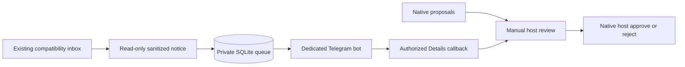
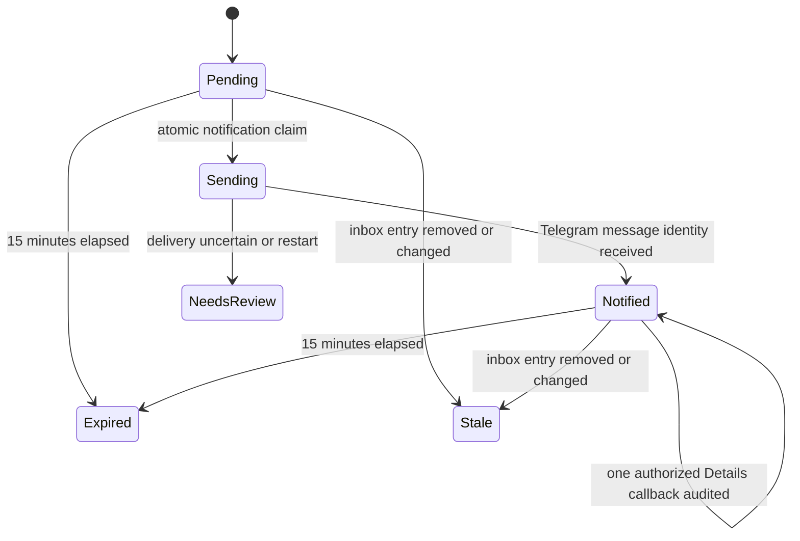

# Telegram Approval P1: notification/manual-review release

This release **cannot approve or reject OpenShell rules through Telegram**.
It implements the design's mandatory fail-closed fallback. The native 0.1.2
CLI contract does not provide a verified structured exact-proposal interface.
`NativeAdapter` refuses discovery, exact retrieval, approval and rejection;
there is no feature flag that enables writes. No live native acceptance ran.

The pinned [0.1.2 CLI source](https://github.com/NVIDIA/OpenShell/blob/v0.1.2/crates/openshell-cli/src/main.rs)
(`DraftCommands::Get`, lines 1836–1847) exposes a sandbox and status filter but
no structured output or exact chunk selector. Its documented manual commands
are in the [0.1.2 policy advisor guide](https://docs.nvidia.com/openshell/v0.1.2/how-it-works/policies/advisor).
The sandbox-local agent API is not a verified host approval API. Do not build
approval authority by parsing terminal output or DENIED logs. A later reviewed
adapter needs exact native sandbox identity, complete rule scope, risk findings,
effective policy/provider fingerprint and confirmed post-action state, plus
separately authorized dummy-only host acceptance. Do not upgrade pins to bypass
this gate.



The bridge reads `state_root/<project-id>/inbox.json`; it does not refresh it,
read live logs, invoke native CLI commands, change policy, touch the guest or
start a Gateway/VM. An absent inbox means no notices. Existing operator
`openshell-manager rules pending --project ... --host ...` can refresh the
compatibility inbox when separately authorized; it contacts native services.
Forged native IDs, descriptions, HTTP method/path and arbitrary log content are
ignored. Only validated endpoint fields for the established curl/Codex binaries
are copied. Inbox content is untrusted notification context, never authority.

## Operator setup (explicit actions, not performed by package installation)

Use one Linux host, one active project, one dedicated bot, and one canonical
Manager `state_root`. All project profiles on this host must share that root
for the host-wide bridge lock. Separate roots bypass that coordination and are
outside P1. Do not share this bot with OMA M11 Gate or another poller.

1. Install the reviewed immutable Manager commit as described in
   [packaging.md](../packaging.md). Verify its identity with
   `openshell-manager version`. Review the project's `manager_revision` and
   existing state binding. Existing binding/pin mismatch requires a separate
   reviewed migration; setup never rewrites an existing binding.
2. On an explicitly authorized host, run the setup command below. It reuses
   Manager profile validation, source/edit scope guards, provenance, project
   binding and provider-template checks. It prepares existing Manager local
   state only; it does not configure credentials, native proposals, automatic
   approval or systemd.
3. Create a dedicated bot using Telegram's normal operator process. Verify the
   Founder's numeric Telegram user ID and intended numeric chat ID through a
   trusted channel. IDs are identities, not usernames. Both must match each
   callback. Keep the token exclusively on the host, outside source checkouts,
   guest mounts, snapshots, shared paths and Git. A private JSON file must have
   exactly `bot_token`, `user_id` and `chat_id`. Set directories to 0700 and the
   file to 0600, owned by the service user. Enter the actual token privately;
   never put it in command arguments, public config, examples or logs.
4. Start `serve` manually to verify notifications, or explicitly install and
   enable the reviewed systemd template. Running serve contacts Telegram;
   obtain operator authorization before live testing. This implementation's
   tests never contacted Telegram.

```bash
openshell-manager approval setup --project /private/project.json --host /private/host.json
openshell-manager approval serve --project /private/project.json --host /private/host.json --bot-config /private/telegram.json
openshell-manager approval status --project /private/project.json --host /private/host.json
openshell-manager approval pending --project /private/project.json --host /private/host.json
openshell-manager approval stop --project /private/project.json --host /private/host.json
```

`MANAGER_PROJECT` and `MANAGER_HOST` remain supported; explicit options win.
OpenShell environment overrides are refused. Bot configuration is required only
for `serve`, never loaded for status/pending/stop. Every operation checks Manager
provenance/profile/binding before state use. Status/pending open SQLite read-only
and do not create a queue. Their queue state output is not proof of live bot or
native health. Use systemd's status command to inspect the service process.

The private bot JSON has this shape (replace the placeholder privately):

```json
{"bot_token": "<DEDICATED_HOST_BOT_TOKEN>", "user_id": 123456789, "chat_id": 123456789}
```

The bot uses the outbound [Telegram Bot API](https://core.telegram.org/bots/api)
with `getUpdates` long polling. No webhook, listener or public port is opened.
Messages use plain text, no Telegram markup or preview. Notice metadata includes
endpoint/executable and a generic exposure risk; no raw logs, arbitrary reasons,
paths, native chunk IDs or full policies are sent. Telegram receives these
sanitized endpoint fields, so use a private intended chat.

The only button is **Details**. It returns a fixed manual-review explanation.
Approve rule/Reject buttons are deliberately absent while native verification
is blocked. Never treat Details, a local notice ID or a forged callback as a
native decision. Callback tokens are random, opaque, stored only as hashes,
message-bound, single-use, and expire 15 minutes after observation. That TTL
expires the callback, not a native proposal or an already-approved rule.

## Queue, recovery and shutdown



State lives in private `state_root/<project-id>/approval/queue.sqlite3`:
requests, callback hashes, sanitized audit events, bound project/bot identity
and durable update offset. Files are 0600, approval directory 0700; unsafe
ownership, links or permissions are refused. Bot identity is represented by a
hash, never the token. A changed project profile or bot binding stops service;
there is no automatic adoption. The poller revalidates profiles each cycle.

A host-wide nonblocking `flock` prevents two Manager bridges sharing the canonical
state root. It releases automatically on process exit. Telegram failures cause
bounded backoff (up to 30 seconds) and never grant permission. Poll timeout is
25 seconds; HTTP deadline is 35 seconds. Poll offsets advance only after callback
handling. Replayed callbacks cannot repeat a decision. An interrupted `sending`
or legacy `applying` journal entry becomes `needs_review`; neither is retried.
No runtime native approval can be persisted into permanent project policy here.

Delivery cannot be exactly once across a lost HTTP response. This fallback
prioritizes avoiding duplicate sends: uncertain sends remain `needs_review` even
if Telegram never received them. Inspect such rows and manually review the native
host. Recovery continues polling and notifying newly observed endpoints; it does
not silently resend uncertain entries. Scope duplicates remain one notice across
restarts, including expired notices. Queue limit is 10,000 unique entries, inbox
limit 1 MiB/1,000 entries, pending output limit 1,000 rows. Retain audit and arrange
an explicitly reviewed archive/migration when limits are reached; no automatic
queue deletion or regeneration is supplied.

`approval stop` writes a private cooperative stop marker. The bridge exits after
the current bounded poll/backoff. It sends no process signal and deletes no native
rule. A subsequent explicit serve clears the marker under the single-instance
lock. Stop the systemd service as well when disabling it; killing a poller during
delivery can leave an uncertain notice, which is safe and visible on restart.

## Optional systemd user service

Copy [the service template](openshell-manager-approval.service) to
`~/.config/systemd/user/openshell-manager-approval.service` only after reviewing
and replacing **all** absolute paths. The CLI path must point to the installed
uv tool. The bot file is read directly; its token never appears in ExecStart.
Private state parents must be owned by the service user and 0700. No installer,
package update or setup command executes any command below.

```bash
systemctl --user daemon-reload
systemctl --user enable --now openshell-manager-approval.service
systemctl --user status openshell-manager-approval.service
# Disable and stop explicitly; keep the queue/audit and native sandbox intact.
systemctl --user disable --now openshell-manager-approval.service
```

Do not enable lingering, change active host settings or restart native resources
as part of this feature without separate authorization. Service SIGTERM/SIGINT
allows orderly journal closure. The template restarts failures after 15 seconds;
configuration errors should be investigated and the service disabled meanwhile.

## Troubleshooting and rollback

- **Native approval disabled:** expected. On the host, manually run
  `openshell rule get <verified-sandbox-name> --status pending`. Review complete
  exact scope, binary, risks and current effective policy/provider before using
  the native chunk ID with `openshell rule approve` or `openshell rule reject`.
  Never substitute the compatibility notice ID. Approved native network rules
  may remain effective beyond a single request; use the term **Approve rule**.
  No filesystem/process/GitHub/credential grant is authorized through Telegram.
- **No notices:** verify the existing inbox has pending compatible entries and
  the bot is dedicated. This fallback does not discover live native proposals.
- **Telegram unavailable:** inspect pending/status locally. Check connectivity,
  the dedicated bot, private credentials and chat membership without printing
  tokens. No permission was granted. `needs_review` entries require host review.
- **Operation refused:** check approved immutable Manager pin, project origin,
  source/edit scopes, project binding, private path ownership/modes, symlinks and
  absence of OpenShell overrides. Errors intentionally omit sensitive details.
- **Another bridge active:** stop the existing Manager poller first. Do not delete
  the lock file or start a second bot consumer. Use the same canonical state root.
- **Stale/expired/replayed Details:** refresh and inspect on the host. Tokens never
  renew native authority; notifications do not authorize grants.
- **Credential rotation/project migration:** stop service, preserve queue/audit,
  and perform a separately reviewed binding migration. Never delete state merely
  to bypass a binding refusal.

Rollback: disable/stop this service, retain the audit, reinstall the previously
approved pinned Manager version using the packaging runbook, and continue native
manual review. Do not delete or rewrite policy, sandbox, provider, credentials or
pending proposals. Review uncertain native activity independently; this fallback
never executes native mutations. Live Telegram/native acceptance remains SKIP.
