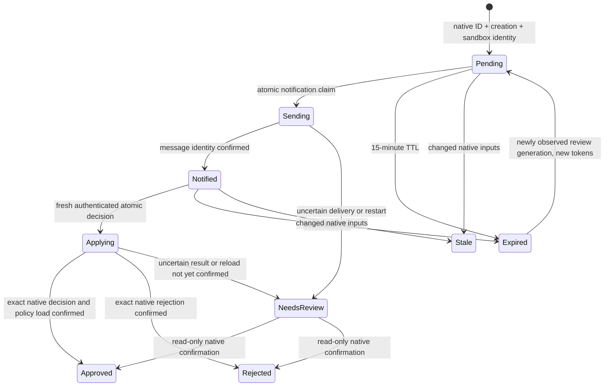

# Telegram Approval P1 operator runbook

The bridge now discovers and decides **native OpenShell v0.1.2 network-rule
proposals** through authenticated Gateway RPCs. Compatibility-inbox notices remain
read-only fallback. Source/schema/decision evidence and remaining native limits
are in [native-api-v0.1.2.md](../native-api-v0.1.2.md); live acceptance remains SKIP.
For the step-by-step isolated real test and deployment gate, use
[First real run](telegram-approval-live.md). No live action is authorized by this document.
Package installation, updates and approval setup never start/enable a service,
configure native proposals or change Gateway/VM settings.

```mermaid
sequenceDiagram
    participant A as Agent in sandbox
    participant O as OpenShell 0.1.2
    participant B as Host bridge
    participant Q as Private SQLite queue
    participant T as Dedicated Telegram bot
    participant F as Founder
    A->>O: Submit exact network proposal through policy.local
    B->>O: Poll native pending proposals and effective configuration
    O-->>B: Native chunk, complete rule, findings and review token
    B->>Q: Bind sandbox ID, proposal identity and review generation
    B->>T: Scope/risk notice with expiring opaque buttons
    T->>F: Approve rule / Reject / Details
    F->>B: Authorized user + chat + message callback
    B->>O: Re-read exact proposal and policy/provider state
    B->>Q: Atomic decision claim and durable operation UUID
    B->>O: One exact reviewed approval or rejection
    B->>O: Confirm proposal and resulting policy/load state
    B->>Q: Durable confirmed decision or needs_review
    B->>T: Confirmed status; remove decision buttons
    O-->>A: Approved and locally loaded, or rejected with reason
    A->>O: Retry normally after policy_reloaded=true, or redraft
```

## Preconditions and explicit operator setup

Use one host, one active project, one dedicated bot and one canonical Manager
state_root. Do not share the bot with OMA M11 Gate or another poller. The host-wide
lock coordinates all Manager pollers sharing this state root; other roots and
other Telegram consumers are outside P1.

1. Install an approved immutable Manager commit using [packaging.md](../packaging.md).
   Verify version/provenance and project manager_revision. Existing project
   bindings cannot be rewritten automatically; pin changes require separately
   reviewed migration. Existing sandbox state.json must bind the actual native
   sandbox ID and unchanged reviewed profile/scopes.
2. Run `approval setup` to validate the project and prepare existing Manager local
   binding/provider-template state. This never configures credentials, native
   approval mode, proposals, Gateway/VM or systemd. Native approval mode must
   **already be MANUAL**. An absent registered setting means native manual
   default; AUTO is refused, never corrected by the bridge.
3. Identify an **existing local HTTPS mTLS Gateway** and exact native workspace.
   The existing native user registry is read from
   `$XDG_CONFIG_HOME/openshell/gateways/<gateway>/metadata.json` (or the standard
   HOME config location). The bridge reuses `mtls/ca.crt`, `mtls/tls.crt` and
   `mtls/tls.key`; it never creates or exports them. Private directory/files must
   be owned by the service user, mode 0700/0600, with no symlinks/hardlinks.
   Remote/plaintext/insecure/OIDC/Cloudflare modes are outside this P1 adapter.
   If credentials/authentication or broader permissions would need changing,
   **stop and ask for an operator decision**; do not change the active Gateway.
4. Create a dedicated bot through the operator's usual Telegram process only
   when authorized. Verify the Founder's numeric user ID AND the intended numeric
   chat ID through trusted channels. Host JSON must have exactly `bot_token`,
   `user_id`, `chat_id`, be owned by the host user and 0600, outside all source
   checkouts, guest mounts, snapshots and Git. Enter the actual token privately,
   never in command arguments/logs or project profiles. This implementation task
   created/read no real Telegram or native credentials.
5. Start serve explicitly with the existing Gateway name. Normal native discovery
   requires **no `rules pending` command** and does not read denial logs. Live
   testing requires separate authorization for an isolated dummy sandbox.

```bash
openshell-manager approval setup --project /private/project.json --host /private/host.json
openshell-manager approval serve --project /private/project.json --host /private/host.json --bot-config /private/telegram.json --gateway existing-local-gateway --gateway-workspace default
openshell-manager approval status --project /private/project.json --host /private/host.json
openshell-manager approval pending --project /private/project.json --host /private/host.json
openshell-manager approval stop --project /private/project.json --host /private/host.json
```

`MANAGER_PROJECT`/`MANAGER_HOST` remain supported; explicit flags win. OpenShell
environment overrides remain refused. Gateway/workspace selection is bound in
private bridge state on its first explicit selection; changing it requires review.
Serve without `--gateway` uses compatibility notification/manual-review mode and
cannot grant permissions. Missing/incomplete native evidence also fails closed.
Status/pending remain read-only, do not load credentials or create a queue and are
not proof of bot/Gateway health. Use systemd status for the service process.

Private bot JSON shape (placeholder is intentionally not a usable credential):

```json
{"bot_token": "<DEDICATED_HOST_BOT_TOKEN>", "user_id": 123456789, "chat_id": 123456789}
```

## What the Founder reviews

Native notices include project/sandbox, stable sandbox and native chunk ID,
executable, host/port and complete serialized requested rule scope, bounded native
risk/security finding categories, policy fingerprint and 15-minute expiration.
No raw rationale/logs, provider secrets or full policies are sent. Known token-like
scope strings are redacted and cannot be approved. Oversized scope is manual-review
only. Telegram uses plain text with no markup/preview.

**Approve rule** is available only for a complete, current, supported proposal with
clean native prover/security evidence. P1 supports explicit HTTPS REST method/path
rules for curl and the pinned Codex executable paths already discovered in the
private Manager tools record. Tool-binding drift invalidates review. A clean
prover result does not override the ban on credentialed destination hosts. It refuses scope that changes existing
network rules, middleware, filesystem, process or Landlock; GitHub/credential grants,
private/wildcard destinations, uninspected access and unsupported scope cannot be
approved. Unsupported complete native proposals offer Reject/Details only.

Both user_id and chat_id must match; token action, message ID, native identity,
policy/provider/instance fingerprints and TTL are checked. Existing Manager
phase/image, Ready/admission/load and reviewed static-policy guards are enforced. The proposal is re-read
under Manager's existing operation lock, then atomically claimed in SQLite; all
sibling decision tokens become processed. Approval sends exactly one explicit
pending chunk/review-token pair. It never submits an empty/blanket approval list,
uses generic policy update, enables AUTO, persists grants to project.json or
executes an agent command.

An approval is reported successful only after native approved status, exact rule
and candidate effective policy, matching revision/hash and LOADED/active version
are confirmed. An immediate pending reload or uncertain result is needs_review;
later read-only reconciliation may confirm it. Telegram status delivery is
retried independently of native mutation. Approved rules can remain effective
beyond one request, so this is **Approve rule**, never Approve once.

Rejection uses the exact chunk ID with a fixed sanitized reason. The agent's normal
policy.local wait exposes rejection and the reason for a narrower proposal.
Native v0.1.2 rejection has no token/CAS field: independent native-admin races can
cause denial/removal of access. Manager verifies freshness before dispatch and
exact result afterward; mismatch is needs_review, never success. This bridge cannot
serialize independent native administrators. If conditional atomic rejection is
required, stop deployment and request a separate decision.

## Queue lifecycle, outages and repeated requests



SQLite remains in private `state_root/<project-id>/approval/queue.sqlite3`.
Additive migration retains earlier compatibility notices, audit and cursor. Native
identity includes Gateway/workspace, sandbox UUID, native chunk ID and creation
identity; scope alone is never identity. New agent-authored proposals get new IDs,
even for identical endpoints after rejection/resolution. Changed review tokens or
policy inputs invalidate old notices and create a fresh review generation. TTL
expiry requires a new notice/new callback tokens; it never extends old authority.
An unchanged identity after uncertain mutation/delivery is held for host review,
never recreated as fresh approval authority. Mechanistic native dedup remains
native-owned and is not reinterpreted as a new agent request.

Random callback tokens are stored only as hashes. Atomic claims prevent concurrent
approve/reject callbacks and replay. The durable audit records actor, action,
operation UUID in the request, before/after policy hashes and confirmed result.
After restart, applying/needs_review is reconciled by reads only; no mutation is
blindly repeated, even with a native request_id. Details does not consume the
Approve/Reject authority. A failed Telegram edit is safe to retry without repeating
the decision.

Native RPC deadlines are 10 seconds with gRPC retries disabled. Telegram long poll
is 25 seconds, HTTP deadline 35 seconds, backoff is capped at 30 seconds. Stop checks
run between native requests/notifications; orderly stop waits for the current
bounded outbound call. Queue is capped at 10,000 entries, native/inbox batches at
1,000 entries, inbox at 1 MiB, notification sends at 10 per cycle. Plan separately
reviewed archival when limits are reached; the bridge never deletes audit to bypass
binding or uncertain state.

An uncertain Telegram send may have been delivered. The bridge does not resend
blindly: needs_review may therefore require manual host discovery. This trades
possible missed delivery for avoiding duplicate active notices. Telegram/native
outages never grant permission. Compatibility-inbox fallback remains read-only,
only Details, and cannot synthesize native proposal identity. It does not promise
automatic native detection when the verified Gateway API is unavailable.

## Optional explicit systemd user service

Review [the template](openshell-manager-approval.service), replace ALL absolute
paths and existing Gateway/workspace placeholders, then copy it to
`~/.config/systemd/user/openshell-manager-approval.service`. The token/key never
appears in ExecStart. Only the operator executes these commands:

```bash
systemctl --user daemon-reload
systemctl --user enable --now openshell-manager-approval.service
systemctl --user status openshell-manager-approval.service
systemctl --user disable --now openshell-manager-approval.service
```

Install/update/setup never runs those commands. Do not enable lingering, modify
Gateway/VM settings or restart active native resources for this task. SIGINT/SIGTERM
closes state safely. `approval stop` writes a private cooperative marker without
signalling another process or deleting rules. Explicit serve clears it under the
single-instance lock; disable/stop systemd as well when retiring the service.

## Troubleshooting and rollback

- **BLOCKED — end-to-end approval unavailable:** check existing supported mTLS
  Gateway, exact v0.1.2 health response, bound sandbox ID/project label/workspace,
  admitted local policy and MANUAL mode. Missing/unknown fields are not authority.
  Do not upgrade native tools, create credentials or change active settings to
  bypass refusal. Ask the operator for a separate decision.
- **No native proposal:** the agent must submit a native proposal through its
  existing policy.local guide/API, or OpenShell must generate one natively. If
  native proposal settings are absent, do not enable them on the active VM here.
  Notifications are automatic once a native pending proposal exists.
- **Approve button absent:** unsupported scope, redaction, oversized rule, risk
  findings, GitHub/credential permissions or changed existing authority. Reject,
  request a narrower proposal or review on the host.
- **Expired/stale/replayed callback:** no mutation occurs. Wait for a fresh review
  generation/new native request; never reuse the old token.
- **needs_review:** inspect exact native chunk and policy load on the host. A
  decision may already have occurred. Never repeat approval just to clear the UI.
- **Operation refused/busy:** check pin/origin/scopes/project and bot binding,
  private ownership/modes/links, the existing operation lock and service status.
  Errors deliberately suppress secret-bearing native/network exception text.
- **Second poller:** stop the existing bridge first; never unlink the lock file.
- **Credential rotation or profile/Gateway migration:** stop the bridge, preserve
  audit and perform a separately reviewed migration; never delete state to bypass
  identity checks.

Rollback: disable/stop the bridge, retain SQLite/audit, reinstall the previously
approved Manager pin with the packaging runbook and continue native manual review.
Do not delete or rewrite sandbox, provider, pending proposals or native policy.
Legacy Manager commands retain their policy-drift guard: a native runtime grant
can require separate reviewed reconciliation for later core operations. The bridge
does not rewrite state.json's reviewed policy or project configuration to bypass it.
A runtime rule already approved remains subject to native semantics; disabling
the bridge does not revoke it automatically. Live proof must use a separately
authorized isolated dummy sandbox with no paid model call or production host change.
