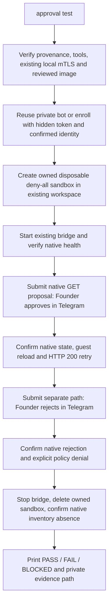

# One-command Telegram approval live test

From a normal host terminal, run:

```bash
openshell-manager approval test
```

No project files, environment exports, second terminal, manual sandbox setup or
proposal IDs are needed. The command creates a fresh isolated fixture and test
sandbox, starts the existing approval bridge as a child, submits real native
proposals and verifies the decisions. It does not call an AI model or enable a
system service. **This procedure has offline test coverage; live B15 is still SKIP.**

On first use, create a dedicated bot through BotFather if necessary. The command
asks for the token with echo disabled, then asks you to send the displayed
`/start <one-use-challenge>` to that bot. Confirm the displayed numeric user/chat
IDs. Only a matching private-chat challenge is accepted. The bot JSON is saved
outside Git and guest data at
`~/.local/state/openshell-manager/approval-live/telegram.json`, mode 0600.
On subsequent runs the saved configuration is reused without prompts.

The command also discovers existing private bot JSON at
`~/.config/openshell-manager/telegram.json` or
`~/.local/state/openshell-manager/telegram.json`. An existing configuration at a
nonstandard path can be selected once per invocation with `--bot-config FILE`;
it is never copied into project data. Never put a token in command arguments.
Use a dedicated bot, separate from OMA M11 Gate, with no webhook or other poller.

When prompted in the terminal:

1. In Telegram review the exact isolated sandbox, `/usr/bin/curl`, `example.com:443`,
   `GET /`, findings and expiry; click **Approve rule**.
2. Wait for native approval, loaded policy and an actual successful HTTP 200 retry.
3. Review the separate exact `GET /pr3b-<random-run-id>` proposal; click **Reject**.
4. Wait for native rejection with a reason and an explicit HTTP 403
   `policy_denied` response. The first rule does not cover the second path.

A third submission checks repeated rejected scope if OpenShell creates a new native
identity. It may generate another notification, but requires no third decision:
owned sandbox cleanup removes the pending test resource. Native dedup/refusal is
reported as SKIP, never replaced with a made-up identity. Live replay injection is
SKIP; the command does not forge callbacks or recover opaque tokens. Existing
offline replay/concurrency tests remain the evidence for that check.



## Existing prerequisites

The managed bridge child uses the same package interpreter in isolated Python
mode (`-I`) and a private working directory; cwd/PYTHONPATH cannot supply its code.
Source development therefore needs the normal `uv` editable package environment,
rather than relying only on a `PYTHONPATH` export.

The command checks and reuses these prerequisites; it never installs, repairs or
upgrades them:

- Linux x86_64, existing KVM access, Docker, Git, Python and pinned OpenShell,
  Gateway and VM driver **0.1.2**. The local reviewed Gateway config must already
  use schema v2, VM compute and `127.0.0.1:17670`.
- A verified installed Manager Git revision, or a clean approved development
  checkout. Profiles created by the test bind to that exact verified revision.
  Uncommitted tracked development changes are refused by the existing provenance
  guard; do not bypass it.
- An existing healthy local HTTPS mTLS Gateway. The verified `openshell` registry
  is preferred; otherwise only a unique registry is selected. The mTLS directory
  requires ownership by the host user, 0700, with 0600 certificates/key and no
  links. Unsupported, invalid or missing credentials are BLOCKED; none are created.
- An existing workspace: `default` is preferred, or a sole discovered workspace.
  Ambiguity requires explicit `--gateway NAME` / `--gateway-workspace NAME` options.
  No workspace or active Gateway configuration is changed.
- **Docker image preparation is automatic.** The command first searches private
  `built-image-review.json` receipts in the Manager state root and its immediate
  project directories, preferring `approval-live/built-image-review.json`. It
  rechecks the actual immutable image digest, packaged Dockerfile hash/label,
  pinned Codex version and matching package inventory before reuse. An OMA image
  with Codex alone, but no recipe label/receipt, is insufficient.
  If no fully verified image is available, it builds a dedicated **untagged** test
  image from the packaged, reviewed Manager Dockerfile. The temporary build context
  contains only that Dockerfile; the OMA checkout and host credentials are never
  sent to Docker. First build requires registry/APT/npm connectivity, Docker disk
  space and up to 30 minutes; progress is shown as a bounded WAIT, with raw build
  output withheld. The base and Codex remain pinned; APT/npm dependencies are not
  snapshot locked, so the actual digest and `dpkg-query -W` inventory are recorded.
  Digest/recipe-label inspection and network-disabled, read-only Codex/inventory
  checks must all pass before a genuine mode-0600 receipt is saved at
  `~/.local/state/openshell-manager/approval-live/built-image-review.json`.
  Subsequent runs reverify and reuse it. No existing OMA image is relabeled,
  overwritten, rebuilt or deleted. The dedicated image and private receipt are
  retained after sandbox cleanup for reuse.
- The public HTTPS endpoint `https://example.com/` must return HTTP 200 through
  the approved exact rule. DNS/TLS/outage/upstream errors are failures, not proof
  of permission. No redirects, credentials, query strings or request bodies are
  used for the external probe.

The command may opt in to `agent_policy_proposals_enabled=true` **on its new owned
test sandbox only**, using the supported sandbox setting. MANUAL remains mandatory;
a conflicting effective AUTO/global policy is refused. The bootstrap policy reuses
Manager's deny-all network and existing filesystem/Landlock boundary. No GitHub
provider, remote clone, agent login, model launch or generic policy update runs.

## Isolation, timing and results

Every invocation uses a new `tg-<10 hex characters>-dev` name (17 characters), a
random ownership label and a recorded native UUID. It never adopts existing
sandboxes. Before exec, settings or deletion it verifies its exact native name,
workspace, UUID and ownership/project/image labels. The four existing OMA
sandboxes are never lifecycle targets. The native CLI normally updates its registry `last_sandbox` selection even for
exec. This command gives lifecycle CLI processes a private per-run registry with
mode 0700 directories and 0600 copies of the **existing** mTLS materials. Gateway
name/endpoint/CA identity is checked against the verified adapter before copying.
Those temporary host-only copies are removed on normal exit/Ctrl-C, including
failed tests; no new keys are generated and the real registry/last selection is
untouched. The bridge and parent adapter continue to use the original registry.
The verified image is referenced by its actual local digest. Only the dedicated
untagged fallback image may be built; existing images/tags are never changed or removed.

Timeouts: host checks generally 60 seconds; first image build 1800 seconds; creation 600 seconds, subsequent Ready
180 seconds, admission 120 seconds, bridge health/notification 90 seconds,
Founder decision 14 minutes within the bridge's 15-minute TTL, guest reload
30 seconds, and deletion confirmation 120 seconds. Guest exec has native 35-second
and host 45-second limits; HTTP probes have 20-second limits. First-run Telegram
challenge enrollment allows 5 minutes. Human token/identity input waits for the
operator; Ctrl-C is supported at any point. A running native/HTTP call can finish
up to its bounded deadline after cancellation.

Ctrl-C stops the managed bridge, then attempts deletion of only this run's owned
sandbox. The child gets SIGTERM and up to 45 seconds to exit; a stuck child may
be killed without repeating any native decision. No locks are unlinked. Cleanup
requires confirmed absence from the native sandbox inventory before reporting
success. Ownership drift, transport failure or interruption produces an explicit
unconfirmed-cleanup failure, never a successful cleanup claim.

If approval may already have happened, the command says so. Stopping the bridge
alone does not revoke a runtime rule; deletion of the owned test sandbox must be
confirmed. Existing native-admin rejection race limits still apply; see the
[operator runbook](telegram-approval-p1.md). No uncertain mutation is retried.

`RESULT: PASS` requires both confirmed decisions, policy reload, HTTP 200 retry,
explicit continued denial and confirmed cleanup. `FAIL` means an attempted test
or cleanup did not meet its checks. `BLOCKED` identifies a missing/untrusted
prerequisite. Exit codes are 0 / 1 / 2, or 130 for Ctrl-C when cleanup completes.
An interruption with failed cleanup returns 1.

If image preparation reports BLOCKED, check Docker daemon access, free disk space
and base-registry/APT/npm connectivity, then rerun the same command. Failed builds
or verification never create a new review receipt or fall back to the unverified
OMA tag. A failed build may leave Docker cache or an unreviewed untagged image;
the command does not delete images or prune shared Docker storage.

Private fixture/config, SQLite audit and a sanitized `result.json` are retained
under the normal Manager state directory for diagnosis; the final output gives
its location. The report includes native IDs/hashes/checks and ownership intent,
not bot tokens, keys, raw guest responses or native logs. It records whether a
runtime grant was possible and whether native resource absence was confirmed.
Do not publish raw SQLite or private host files. A hard host/process crash can
leave an owned test sandbox and private temporary CLI credential copies; its durable marker/UUID report must be reviewed
before any separately authorized cleanup. Future runs use new names and never
silently adopt or remove leftovers.

Installing/updating this package, reading help or preparing these docs does not
execute the test. Run it only when authorized to create its isolated test resources
and contact Telegram/OpenShell. No live operation was performed during implementation.
For manual diagnostics, the earlier [detailed procedure](telegram-approval-live.md)
remains available; it is not necessary for the normal one-command workflow.

The execution contract is verified against the immutable OpenShell 0.1.2 source:
[CLI global Gateway/workspace flags](https://github.com/NVIDIA/OpenShell/blob/6648bd0c290efbc41ba131ee9831ee45cd431f94/crates/openshell-cli/src/main.rs#L435),
[noninteractive exec flags](https://github.com/NVIDIA/OpenShell/blob/6648bd0c290efbc41ba131ee9831ee45cd431f94/crates/openshell-cli/src/main.rs#L1673),
[authenticated exec implementation and timeout](https://github.com/NVIDIA/OpenShell/blob/6648bd0c290efbc41ba131ee9831ee45cd431f94/crates/openshell-cli/src/run.rs#L1812),
[local Docker image resolution](https://github.com/NVIDIA/OpenShell/blob/6648bd0c290efbc41ba131ee9831ee45cd431f94/crates/openshell-driver-vm/src/driver.rs#L3203),
and [sandbox-local proposal opt-in](https://github.com/NVIDIA/OpenShell/blob/6648bd0c290efbc41ba131ee9831ee45cd431f94/crates/openshell-core/src/settings.rs#L134).
Runtime CLI help must also advertise the required execution flags before any VM
is created. Native authorization and decisions continue through the existing
[verified proposal adapter](../native-api-v0.1.2.md).

## Native verification diagnostics

Creation now prints the owned sandbox name and UUID verification result, followed
by native admission and guard checkpoints. `result.json` stores only fixed codes
and pass/wait/fail/timeout states under `checks.native_verification`, updated before
cleanup. No full policy, server admission prose, provider data or token is recorded.
The last failed/waiting code identifies the blocker; earlier PASS checks are
historical observations, not a promise that later state remained unchanged.

| Checkpoint | Meaning and action |
| --- | --- |
| `sandbox_identity`, `config_binding`, `guest_tools` | UUID/project/image/scope binding or pinned guest tools differ. Stop; inspect the owned test binding and installed revision. Never adopt another sandbox. |
| `sandbox_ready`, `initial_native_admission`, `native_admission` | Starting/pending states may converge. Rejected admission fails immediately; inspect native compatibility locally without publishing raw errors. |
| `config_schema`, `config_admitted`, `policy_source`, `config_revision` | Unsupported structured data, invalid effective configuration, global policy or missing revision. Stop and check pinned API/config compatibility; do not replace global policy. |
| `provider_revision_attachment` | Missing provider-state revision/attachment epoch, even for zero providers. Stop; check pinned native API compatibility without adding credentials/providers. |
| `admission_instance`, `admission_policy_revision`, `admission_config_revision`, `admission_provider_revision` | Supervisor observation differs from current desired configuration. Bounded 120-second convergence; a timeout reports the specific mismatch. Investigate supervisor configuration loading, not a broader permission grant. |
| `filesystem_guard`, `landlock_guard`, `process_guard`, `middleware_guard` | Effective static authority differs from the reviewed bootstrap. Fail immediately. Never reconcile by weakening the guard. |
| `loaded_schema`, `loaded_policy_revision` | Unsupported policy-status data, pending revision, or failed/superseded load. Pending loads may converge; explicit failed/superseded loads fail immediately. |
| `manual_approval_mode`, `deny_all_network` | AUTO/unsupported mode or unexpected bootstrap network rules. Stop; no test proposal may be submitted. |
| `rpc_METHOD_STATUS`, `rpc_METHOD_precondition`, `native_unclassified` | Named native read/transport failure. UNAVAILABLE/deadline/resource exhaustion/aborted may converge; authentication/permission/precondition failures stop. An unclassified error fails closed without raw exception disclosure. |

The bootstrap explicitly sets `process.run_as_user` and `process.run_as_group`
to `sandbox` **before creation**. OpenShell v0.1.2's policy parser preserves an
omitted process block, and canonicalization does not insert these fields. The
previous bootstrap omitted it while our strict adapter expected explicit fields,
which reproduces a permanent `process_guard` failure offline. Existing images,
Gateway settings and live sandbox policies are not changed by this correction.
The original live report did not retain invariant evidence, so this reproducible
incompatibility is not proof that it was the only failure on that host.

Pinned source evidence:
[policy parser maps the optional process block](https://github.com/NVIDIA/OpenShell/blob/6648bd0c290efbc41ba131ee9831ee45cd431f94/crates/openshell-policy/src/lib.rs#L621),
[canonicalization preserves process omission](https://github.com/NVIDIA/OpenShell/blob/6648bd0c290efbc41ba131ee9831ee45cd431f94/crates/openshell-policy/src/lib.rs#L1872),
[create validates and persists the supplied policy](https://github.com/NVIDIA/OpenShell/blob/6648bd0c290efbc41ba131ee9831ee45cd431f94/crates/openshell-server/src/grpc/sandbox.rs#L531),
[provider revision hashes even an empty record set](https://github.com/NVIDIA/OpenShell/blob/6648bd0c290efbc41ba131ee9831ee45cd431f94/crates/openshell-server/src/grpc/policy.rs#L2970).
